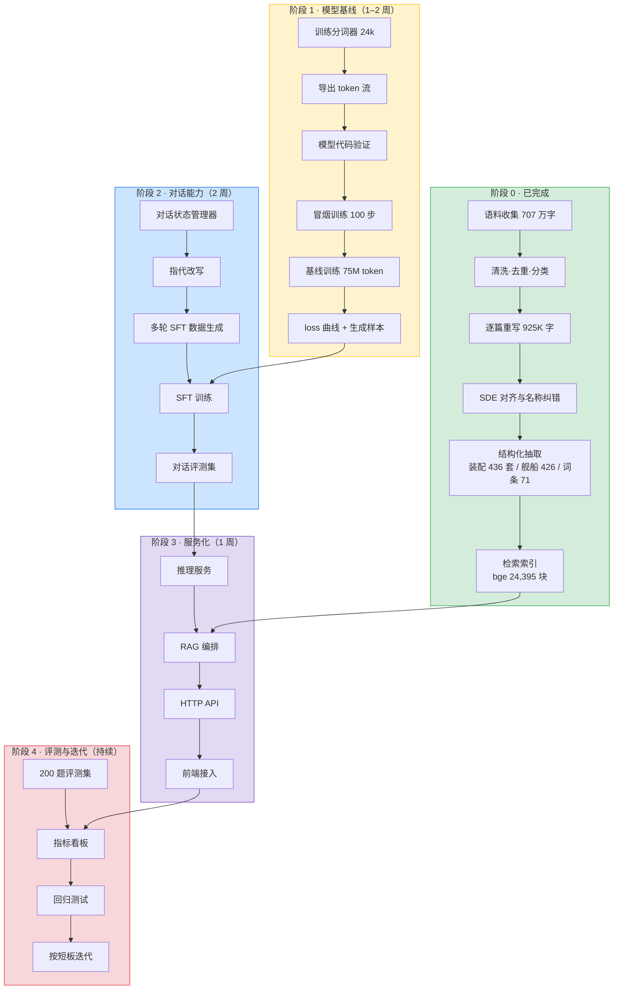

# EVE 领域模型 · 生产交付流程图

> 版本 1.0 · 2026-11-01
> 依据：本项目已完成的语料层、检索层，以及已拍板的模型方案（42M 深窄 Transformer + QK-Norm + Muon，上下文 1024）

---

## 一、总览



---

## 二、阶段 0 · 已完成（基线资产）

| 交付物 | 位置 | 规模 | 验收状态 |
|---|---|---|---|
| 重写语料 | `canonical/` | 654 篇 / 925,585 字 | ✅ 全部 drafted |
| 原文留存 | `canonical/*/source.md` | 707 万字 | ✅ 可溯源 |
| SDE 卡片 | `data/sde_cards.jsonl` | 7,591 张 | ✅ build 3662168 |
| 装配库 | `data/fits.jsonl` | 436 套 / 183 艘 | ✅ 结构化 |
| 舰种索引 | `canonical/.../舰种索引` | 48 舰种 | ✅ 标题可精确匹配 |
| 剧情词条 | `canonical/.../词条索引` | 71 条 | ✅ 出现 ≥3 次 |
| 检索索引 | `index/` | 24,395 块 × 512 维 | ✅ bge，21ms/次 |
| 名称纠错 | `data/ship_names_full.md` | 426 艘 + 11 条错写 | ✅ SDE 为准 |

**这一阶段的意义**：模型训练所需的一切原料已经就位，且每一条都能追溯到来源或 SDE。

---

## 三、阶段 1 · 模型基线（关键路径，1–2 周）

### 顺序不能颠倒

```
B1 分词器 → B2 语料导出 → B3 代码验证 → B4 冒烟 → B5 基线训练 → B6 评估
```

### 1.1 训练分词器（0.5 天）

| 项 | 内容 |
|---|---|
| 输入 | `canonical/` 全部 `source.md` + `rewrite.md`，约 817 万字符 |
| 算法 | BPE 或 Unigram，词表 24,576 |
| 特殊 token | `<pad> <eos> <bos> <unk> <im_start> <im_end> <|user|> <|assistant|>` |
| 产出 | `tokenizer/`（vocab + merges） |
| 验收 | 中文压缩率 ≥ 0.85 字/token；特殊 token 可编码解码还原 |

**为什么先做**：词表决定序列长度、显存、训练步数，是所有后续工作的前提。

### 1.2 导出 token 流（0.5 天）

| 项 | 内容 |
|---|---|
| 输入 | `canonical/` + `data/*.jsonl` |
| 输出 | `data/train.bin`（uint16 交错存储） |
| 规模 | 约 5M token（去重后 4.2M） |
| 切分 | 训练 98% / 留出 2% 做验证 |
| 验收 | 反解出的文本与原文一致；pad 不参与 loss |

### 1.3 模型代码验证（0.5 天）

| 检查项 | 通过标准 |
|---|---|
| 参数计数 | 与配置推算一致（约 35M） |
| 前向形状 | `[B,T] → [B,T,V]` |
| 反向传播 | 梯度非 NaN，范数合理 |
| 权重键名 | 与 HF Llama 对齐，可导出 |
| 显存 | batch 4 × 1024 下 < 2GB（fp32） |

**这一步是重点**：现有 600 行代码从未执行过，必须先证明它没有形状错误。

### 1.4 冒烟训练（0.5 天）

- 跑 100 步，检查 loss 是否下降
- 检查学习率调度、梯度裁剪、日志
- 产出 `ckpt/smoke.pt`

### 1.5 基线训练（3–5 天）

| 项 | 值 |
|---|---|
| 数据 | 5M token × 15 轮 = 75M token |
| 上下文 | 1024 |
| 优化器 | Muon（矩阵参数）+ AdamW（嵌入/归一化） |
| 学习率 | 3e-4 峰值，余弦退火，100 步 warmup |
| 设备 | RTX 3050 4GB（CUDA）或 CPU 兜底 |
| 预计耗时 | GPU 8–12 小时 / CPU 3–5 天 |
| 产出 | `ckpt/base.pt` + loss 曲线图 |

### 1.6 基线评估（0.5 天）

| 指标 | 通过线 |
|---|---|
| 验证集 loss | 明显低于随机（< 5.0） |
| 生成连贯性 | 能续写完整段落，不重复崩坏 |
| 术语正确率 | 抽查 50 个 EVE 术语，≥ 80% 用对 |

**阶段 1 出口条件**：有一个能续写 EVE 文本的 42M 模型，loss 曲线可复现。

---

## 四、阶段 2 · 对话能力（2 周，可与阶段 1 并行开工）

### 2.1 对话状态管理器（1–2 天，纯 CPU）

```
用户输入 → 读历史 → 解析指代 → 改写查询 → 调检索 → 组装 prompt → 喂模型
```

状态结构：

```json
{
  "turn": 3,
  "active_entity": {"name": "多米尼克斯级", "typeID": 645},
  "answered": ["高槽 6", "中槽 5"],
  "pending": "低槽",
  "summaries": ["用户在配多米尼克斯，关注槽位"]
}
```

验收：连续 5 轮追问同一实体，检索命中率不下降。

### 2.2 指代改写（1 天）

| 输入 | 改写为 |
|---|---|
| 那它的中槽呢 | 多米尼克斯级有几个中槽 |
| 这个怎么配 | 多米尼克斯级怎么配船 |
| 换成毒蜥呢 | 毒蜥级怎么配船 |

规则 + 实体表即可，不需要模型。

### 2.3 多轮 SFT 数据生成（2–3 天）

**这是本项目最大的数据杠杆**：从已有结构化资产自动生成问答对。

| 来源 | 可生成 | 形式 |
|---|---|---|
| SDE 卡片 7,591 张 | 2–3 万条 | 「X 有几个高槽」「X 的护盾多少」 |
| 装配库 436 套 | 1,500 条 | 「X 怎么配」「这套装配用什么弹药」 |
| 舰种索引 48 组 | 500 条 | 「XX 舰一般几个中槽」 |
| 剧情词条 71 条 | 300 条 | 「X 是什么势力」 |
| 重写稿 | 5,000 条 | 「怎么刷深渊」「挖坟收益」 |
| **合计** | **约 3–4 万条** | 含多轮追问 |

验收：抽样 100 条人工检查，答案正确率 ≥ 90%。

### 2.4 SFT 训练（3–4 天）

| 项 | 值 |
|---|---|
| 数据 | 3–4 万条，按 1024 切 |
| 方法 | 全参数微调（42M 不需要 LoRA） |
| 学习率 | 1e-4，10% warmup |
| 产出 | `ckpt/sft.pt` |

### 2.5 对话评测集（1–2 天）

- 200 题，覆盖事实 / 配装 / 舰种 / 剧情 / 多轮
- 每题标注标准答案与期望来源
- 指标：准确率、引用来源命中率、拒答率（不知道就说不知道）

**阶段 2 出口条件**：能连续 5 轮对话不丢上下文，事实类问题准确率 ≥ 70%。

---

## 五、阶段 3 · 服务化（1 周）

### 3.1 推理服务

| 项 | 方案 |
|---|---|
| 引擎 | PyTorch（GPU）或 llama.cpp（CPU/量化） |
| 显存 | 42M fp32 = 140MB，CPU 也能跑 |
| 吞吐 | GPU > 200 tok/s，CPU 20–40 tok/s |
| 接口 | `/chat`（多轮）、`/search`（仅检索） |

### 3.2 RAG 编排

```
问题 → 状态管理器 → 检索（bge 21ms）→ prompt 组装（≤1024）→ 模型 → 引用回填 → 回答
```

引用回填规则：模型不生成 `[1]`，由系统按检索块与回答的字面重合度回填。

### 3.3 API 与前端

- FastAPI + 流式输出
- 前端只需一个对话框 + 来源展示

**阶段 3 出口条件**：本地起服务，浏览器可用，响应 < 3 秒/轮。

---

## 六、阶段 4 · 评测与迭代（持续）

| 指标 | 现状 | 目标 |
|---|---|---|
| 事实准确率 | 未测 | ≥ 85% |
| 配装可用率 | 未测 | ≥ 70% |
| 多轮连贯性 | 未测 | ≥ 80% |
| 幻觉率（编造数值） | 未测 | ≤ 5% |
| 单轮延迟 | 检索 21ms | < 3s 端到端 |

**迭代原则**：先补数据，再调模型，最后调参数。数据问题不要用模型解决。

---

## 七、依赖关系与并行

```
B1 分词器 ──┬──> B2 语料 ──> B3 验证 ──> B4 冒烟 ──> B5 基线 ──┐
            │                                                    │
C1 状态机 ──┴──> C2 指代改写 ──> C3 SFT 数据 ──> C4 SFT ──────────┤
                                                                 │
D1 推理服务 ──────────────────────────────────────────────────────┴──> D2 RAG ──> D3 API ──> E2 评测
```

**可并行的两条线**：

- 线 A（模型）：B1 → B5
- 线 B（对话）：C1 → C3

C3 的 SFT 数据生成**不依赖模型**，可以先用现成的结构化数据做完。

---

## 八、时间表

| 周 | 线 A（模型） | 线 B（对话） |
|---|---|---|
| 第 1 周 | 分词器 → 语料 → 代码验证 | 状态机 + 指代改写 |
| 第 2 周 | 冒烟 → 基线训练 | SFT 数据生成 |
| 第 3 周 | 基线评估 | SFT 训练 |
| 第 4 周 | 调参迭代 | 评测集 + 服务化 |

**第 4 周末**：可交付的本地对话系统。

---

## 九、风险与预案

| 风险 | 概率 | 影响 | 预案 |
|---|---|---|---|
| CUDA 轮子下不下来（2.5GB） | 高 | 训练慢 10 倍 | 先用 CPU 跑通；或云端租 GPU 训练，权重拉回本地推理 |
| 5M token 过拟合 | 高 | 模型只会背书 | 加大 dropout、早停；事实依赖 RAG 而非模型 |
| 42M 上下文利用率低 | 中 | 多轮丢约束 | 靠状态管理器压缩历史，不靠模型记忆 |
| SFT 数据质量差 | 中 | 答非所问 | 自动生成 + 抽检 100 条人工过 |
| 评测集偏差 | 中 | 指标虚高 | 按域分层抽样，覆盖冷门问题 |

---

## 十、交付物清单

| 编号 | 交付物 | 阶段 | 验收 |
|---|---|---|---|
| P1 | `tokenizer/` 24k 词表 | 1.1 | 压缩率 ≥ 0.85 |
| P2 | `data/train.bin` | 1.2 | 可反解 |
| P3 | `ckpt/base.pt` + loss 曲线 | 1.5 | loss < 5.0 |
| P4 | `src/dialogue.py` 状态机 | 2.1 | 5 轮不丢上下文 |
| P5 | `data/sft.jsonl` 3–4 万条 | 2.3 | 抽检 ≥ 90% |
| P6 | `ckpt/sft.pt` | 2.4 | 事实准确率 ≥ 70% |
| P7 | `eval/questions.jsonl` 200 题 | 2.5 | 分层覆盖 |
| P8 | `serve/api.py` + 前端 | 3.3 | 端到端 < 3s |
| P9 | 评测报告 | 4 | 五项指标齐全 |

---

## 十一、当前所处位置

```
阶段 0  ██████████ 完成
阶段 1  ░░░░░░░░░░ 未开始（torch 已装 CPU 版，模型代码改到一半）
阶段 2  ░░░░░░░░░░ 未开始
阶段 3  ░░░░░░░░░░ 未开始
阶段 4  ░░░░░░░░░░ 未开始
```

**下一步动作**：完成 1.3 模型代码验证——这是唯一一处「写了但从未执行过」的代码，必须先证明它能跑。
